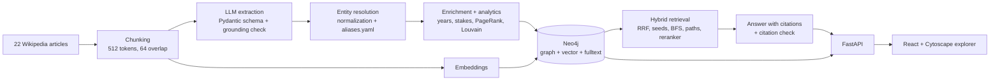

# GraphRAG Explorer

Explore how Austrian banks, their owners and regulators are connected, with every fact traceable to its source
sentence. 22 Wikipedia articles become a knowledge graph in Neo4j. Questions are answered with hybrid
graph + vector retrieval and citations, and the graph can be browsed, searched and path-searched in a React UI.



## Setup in 5 commands

```bash
cp .env.example .env                    # add GEMINI_API_KEY (free at aistudio.google.com)
uv sync && docker compose up -d neo4j   # Python deps + Neo4j 5 (browser at :7474)
uv run python -m backend.ingest         # builds the graph (idempotent; LLM calls cached in .cache/)
uv run uvicorn backend.api:app --no-access-log      # API, docs at http://localhost:8000/docs
cd frontend && npm install && npm run dev           # explorer at http://localhost:5173
```

Other useful commands:

```bash
uv run python -m backend.check          # smoke test: Neo4j, chat model, embedding model
uv run python -m backend.pipeline "How is ÖGB connected to GoldenTree?" --mode graph   # CLI
uv run python -m eval.run               # evaluation (see below)
uv run python -m scripts.warm_demo      # pre-caches the demo answers before a talk
uv run pytest && uv run ruff check .    # 77 tests, lint
```

Ingestion calls the LLM about 160 times (once per chunk, plus the enrichment pass). If a run fails on quota
limits, it writes nothing and resumes from the cache on the next run. The corpus is committed in `data/raw/`, and
`uv run python scripts/fetch_data.py` downloads it again.

## How it works

| Step | What | Where |
|---|---|---|
| Extraction | One LLM call per chunk, structured output against a Pydantic schema. Each item is validated on its own; relations whose quote isn't supported by the chunk (word-level, ≥ 0.9) are dropped | `backend/extraction.py` |
| Resolution | Umlaut transliteration, legal suffixes, and a curated `data/aliases.yaml` for the merges a rule can't make safely | `backend/resolution.py` |
| Enrichment | A second pass adds start/end year and stake % to ownership edges, numerically grounded in the text | `backend/enrichment.py` |
| Analytics | PageRank over reversed OWNS edges (influential owners), group size, betweenness (bridges), Louvain communities | `backend/analytics.py` |
| Retrieval | Vector + fulltext search fused by RRF (k = 60), seed entities from the question, 2-hop BFS with hub control, shortest paths between seeds, cross-encoder reranker, reserved passage slots for path evidence | `backend/search.py`, `backend/graph_retrieval.py` |
| Answer | Facts + passages → answer with `[chunk]` citations; citations the model didn't see are removed | `backend/answer.py` |
| API | FastAPI with readiness check, request IDs, JSON logs, concurrency limit, input limits | `backend/api.py` |
| UI | Search, expand on click, entity cards with source quotes, path finder, insights, ask panel that highlights the edges used | `frontend/src/` |

**Graph schema**

```
(:Chunk {id, doc, title, section, text, url, embedding})-[:MENTIONS]->(:Entity)
(:Entity {key, name, type, aliases, description, degree, owner_rank, group_size, betweenness, community})
(:Entity)-[:RELATES {type, chunk_ids, evidence, start_year, end_year, stake_percent}]->(:Entity)
```
Entity types: BANK, COMPANY, PERSON, REGULATOR, GOVERNMENT, LOCATION, EVENT, OTHER. Relation types: OWNS,
ACQUIRED, MERGED_WITH, SUPERVISES, LEADS, FOUNDED, HEADQUARTERED_IN, INVOLVED_IN, RELATED_TO.
The current graph has 726 entities and 585 relations.

**LLM providers.** All providers go through the OpenAI-compatible API, with a preset each in `backend/config.py`.
Switch with `LLM_PROVIDER` (`gemini` | `cerebras` | `mistral` | `groq`). Answer and judge models can be set
separately (`ANSWER_*`, `JUDGE_*`), and embeddings via `EMBED_PROVIDER` (`gemini` | `mistral`). Calls are
rate-limited, cached on disk by request content, and fall back to the next model on 429/503/timeout.

## Evaluation

`uv run python -m eval.run` (methodology in `NOTES.md`, Phase 5). The questions are generated from the **text,
not the graph**, because graph mode would otherwise be graded on its own data. The answers come from Gemini and
the judge from Groq `gpt-oss-120b`, a different vendor to avoid self-preference bias. A second judge (Qwen)
checks reliability, and all comparisons are paired.

**Main set: 28 questions** (13 multi-hop, 10 lookup, 5 corpus-wide), `eval/results.md`:

| | vector (baseline) | graph |
|---|---|---|
| judge score [95% CI] | 0.91 [0.84, 0.98] | 0.93 [0.86, 0.98] |
| correct | 23/28 | 24/28 |
| recall@8 | 0.90 | 0.89 |
| LLM latency p50 / tokens per question | 1.3 s / 2.9k | 1.3 s / 3.5k |

**Pre-registered hard set: 8 "How is A connected to C?" questions** with a hidden bridge, `eval/results_hard.md`:

| | vector | graph |
|---|---|---|
| judge score | 0.38 | 0.44 (diff +0.06, CI [−0.12, +0.25]) |
| correct | 3/8 | 2/8 |
| recall@8 (without reranker) | 0.56 (**0.81**) | 0.50 (0.56) |

**Honest reading**
- On this small, clean corpus, GraphRAG gives **no measurable QA advantage**. The differences are within noise,
  and graph mode costs about 25% more tokens plus an extraction step.
- Round 1 hit a **ceiling effect**: generated questions reuse the passages' wording.
- The pre-registered hypothesis (the graph helps when the bridge is hidden) is **not supported** at n = 8.
- The largest measured effect: **the reranker hurts** connection questions.
- The graph's value here lies in what QA accuracy doesn't measure: exploration, provenance, time and stake on
  ownership, analytics, and errors you can see.

## Limitations

- **Extraction recall.** Facts the LLM missed are not in the graph. For example, "Addiko was spun off from Hypo"
  is missing, so the path finder links BayernLB and Addiko only through the ECB, which supervises both.
- **Entity resolution** is rules plus a hand-curated alias list, which works at this scale but is not general.
- **Corpus-wide questions** ("which banks does the ECB supervise?") get partial answers, because top-k retrieval
  sees at most 8 passages.
- **Evaluation:** small n, LLM-generated questions, and judge validity still waiting for 10 human labels
  (`eval/calibration_sheet.md`). Inter-judge agreement is κ = 0.62 / 0.69.
- **Free-tier APIs:** quotas and latency vary. Not built: auth, multi-tenancy, Docker images for the app, CI.

## Next steps

1. **Data:** a larger, messier corpus (annual reports, news) where vector RAG should struggle more; incremental
   ingestion per document.
2. **Extraction quality:** measure relation precision/recall on a small hand-labelled sample; try a second
   extraction pass or a stronger model only for chunks with few relations.
3. **Retrieval:** a router that uses graph mode only for connection/aggregation questions; Cypher aggregation for
   corpus-wide questions; skip the reranker for path evidence.
4. **Evaluation:** more questions written by people, human calibration of the judge.
5. **Product:** a timeline filter on ownership edges (data is already there); EU-hosted or local models for
   confidential documents.
6. **DevOps:** multi-stage Dockerfiles, a Jenkins pipeline (lint, tests, build, retrieval-only eval smoke test
   via `eval.run --retrieval-only --limit`), Kubernetes manifests, and scheduled re-ingestion with Airflow.

## Layout

| Path | Contents |
|---|---|
| `backend/` | Python: config, LLM client, ingestion, retrieval, answering, API, tests |
| `frontend/` | React + TypeScript + Cytoscape explorer |
| `eval/` | question sets, judge, runner, results |
| `slides/` | presentation plan and beamer deck |
| `scripts/` | data download, demo warm-up |
| `prototype/` | throwaway Streamlit prototype |
| `data/raw/`, `data/aliases.yaml` | corpus (committed), curated entity aliases |
| `NOTES.md`, `docs/INTERVIEW_NOTES.md` | concepts and decisions in detail; one-page interview cheat sheet |

## Data attribution

Documents in `data/raw/` are excerpts of English Wikipedia articles, licensed
[CC BY-SA 4.0](https://creativecommons.org/licenses/by-sa/4.0/). Source URLs and revision ids are
in `data/raw/sources.json`.
