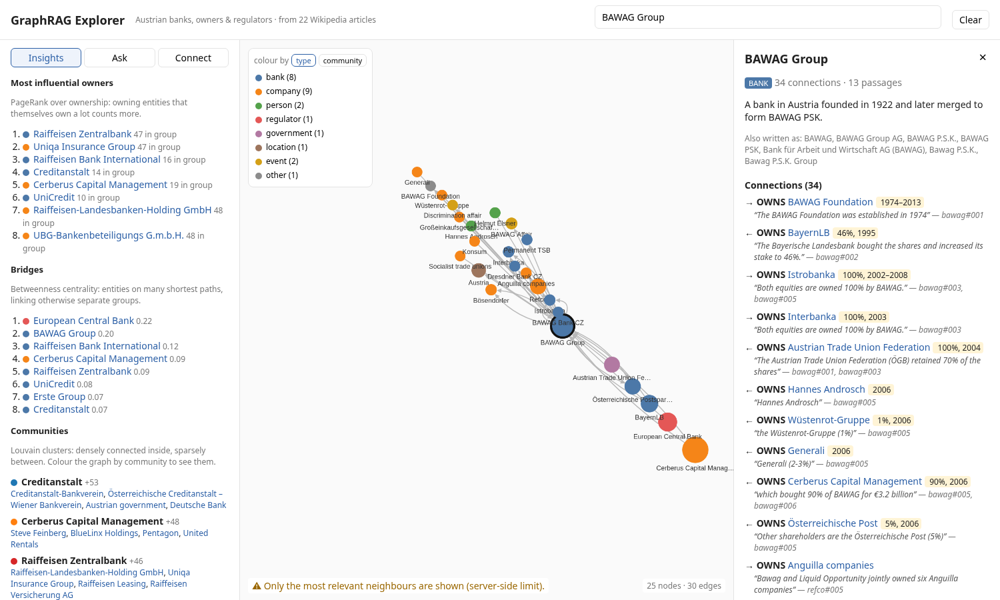
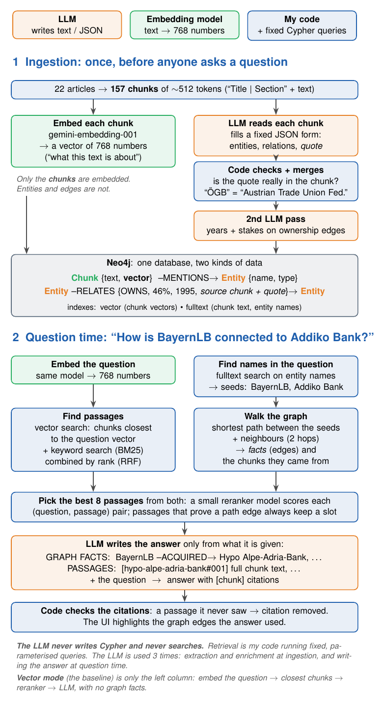

# GraphRAG Explorer

**Explore who owns whom in Austrian banking, and ask questions that are answered with sources.**

22 Wikipedia articles about Austrian banks, their owners and regulators are turned into a knowledge graph.
You can click through it, find the path between any two companies, and ask questions in plain English.
Every fact in the graph links back to the sentence it was taken from.



Things you can find out in a few clicks:
- BayernLB owned 46% of BAWAG in the 1990s, before the trade union ÖGB bought it back, and Cerberus bought it in 2006.
- The Refco scandal links an American broker to an Austrian bank sale.
- Česká spořitelna and Slovenská sporiteľňa are siblings: both belong to Erste Group.

## Features

- **Explorer:** search any entity, expand neighbours by clicking, open an entity card with its connections and
  source quotes. Ownership edges show years and stakes.
- **Path finder:** the shortest connection between any two entities, instantly and without an LLM.
- **Insights:** the most influential owners (PageRank), bridges between groups (betweenness), and clusters of
  banks that belong together (Louvain communities).
- **Ask:** questions answered from the graph and the articles, with citations. The graph edges the answer used
  are highlighted.
- **Evaluation:** a reproducible comparison of graph mode against plain vector RAG, with honest results
  ([below](#evaluation)).

## How it works



There are three separate pieces, and the LLM is not the one that searches:

1. **Ingestion (once).** Each article is split into chunks of about 512 tokens.
   - An **embedding model** turns every chunk into a vector of 768 numbers, which captures what it is about.
   - An **LLM** reads every chunk and fills in a fixed JSON form: entities, relations, and a quote as evidence.
     Code checks that the quote is really in the text, and merges names that mean the same thing
     ("ÖGB" = "Austrian Trade Union Federation").
   - Everything goes into **Neo4j**: chunks with their vectors, entities, and relations that point back to
     their source chunk.
2. **Retrieval (per question), done by code with fixed Cypher queries:**
   - Vector search and keyword search (BM25) find candidate passages, combined by rank (Reciprocal Rank Fusion).
   - Entities named in the question become start points. The graph gives the shortest path between them and
     their neighbours, plus the chunks behind those edges.
   - A small reranker picks the best 8 passages. Passages that prove a path edge always keep a slot.
3. **Answer.** The LLM gets the graph facts, the passages and the question, and writes an answer with
   `[chunk]` citations. Code removes citations of passages the LLM never saw.

The LLM never writes Cypher. **Vector mode**, the baseline, skips the graph: closest chunks, then the
reranker, then the LLM.

<details>
<summary>Graph schema</summary>

```
(:Chunk {id, doc, title, section, text, url, embedding})-[:MENTIONS]->(:Entity)
(:Entity {key, name, type, aliases, description, degree, owner_rank, group_size, betweenness, community})
(:Entity)-[:RELATES {type, chunk_ids, evidence, start_year, end_year, stake_percent}]->(:Entity)
```
Entity types: BANK, COMPANY, PERSON, REGULATOR, GOVERNMENT, LOCATION, EVENT, OTHER.
Relation types: OWNS, ACQUIRED, MERGED_WITH, SUPERVISES, LEADS, FOUNDED, HEADQUARTERED_IN, INVOLVED_IN,
RELATED_TO. The current graph has 726 entities and 585 relations.
</details>

## Getting started

**You need:** Docker, [uv](https://docs.astral.sh/uv/), Node.js 20.19 or newer, and a free
[Gemini API key](https://aistudio.google.com/apikey).

```bash
git clone <this repo> && cd graphRAG-demo
cp .env.example .env                    # then put your GEMINI_API_KEY in .env
uv sync                                 # Python 3.12 environment and dependencies
docker compose up -d neo4j              # Neo4j 5, browser at http://localhost:7474
uv run python -m backend.ingest         # builds the graph: about 160 LLM calls, a few minutes
uv run uvicorn backend.api:app --no-access-log     # API at http://localhost:8000 (docs: /docs)
cd frontend && npm install && npm run dev          # explorer at http://localhost:5173
```

Notes:
- **Ingestion is safe to repeat.** Every LLM and embedding call is cached in `.cache/`, so a second run costs
  nothing. If the free-tier quota runs out halfway, nothing is written, and the next run continues from the
  cache.
- **First question is slow:** the reranker model (about 90 MB) downloads on first use.
- `uv run python -m backend.check` tests the connection to Neo4j, the chat model and the embedding model.

Questions that work well:
- *Who have been the owners of BAWAG over time?*
- *How is BayernLB connected to Addiko Bank?*
- *Which bank held 46% of BAWAG before the trade union bought it back?*
- *How is Česká spořitelna connected to Slovenská Sporiteľňa?*

Other commands:

```bash
uv run python -m backend.pipeline "How is ÖGB connected to GoldenTree?" --mode graph   # ask from the CLI
uv run python -m eval.run                # run the evaluation
uv run pytest && uv run ruff check .     # 77 tests (no network needed), lint
```

## Configuration

All settings are environment variables, set in `.env`; see `.env.example` for the full list.

| Variable | What it does |
|---|---|
| `LLM_PROVIDER` | `gemini` (default), `groq`, `cerebras` or `mistral`. All use the OpenAI-compatible API, with presets in `backend/config.py` |
| `GEMINI_API_KEY`, `GROQ_API_KEY`, ... | key for the chosen provider |
| `ANSWER_PROVIDER` / `JUDGE_PROVIDER` | a different model for answering or for grading the evaluation |
| `EMBED_PROVIDER` | `gemini` or `mistral` (changing it means re-ingesting: the vector size changes) |
| `LLM_RPM` | client-side rate limit, requests per minute |
| `NEO4J_URI`, `NEO4J_USER`, `NEO4J_PASSWORD` | database connection |

LLM calls are rate-limited, cached on disk by their content, and fall back to the next model when one is
overloaded or out of quota.

## Evaluation

`uv run python -m eval.run`. The method is described in `NOTES.md` (Phase 5), and the results are in
`eval/results.md` and `eval/results_hard.md`.

- The questions are written from the **articles, not from the graph**, so graph mode isn't graded on its own
  data.
- An LLM grades the answers against a reference answer. It comes **from a different company** (Groq) than the
  one answering (Gemini), because models tend to prefer their own style. A second grader checks agreement.
- Both modes answer the same questions, so the comparison is paired: bootstrap confidence intervals and McNemar's test.

**28 questions** (13 multi-step, 10 lookups, 5 about the whole collection):

| | plain vector RAG | graph |
|---|---|---|
| score [95% CI] | 0.91 [0.84, 0.98] | 0.93 [0.86, 0.98] |
| correct | 23/28 | 24/28 |
| right passages found (recall@8) | 0.90 | 0.89 |
| answer time (median) / tokens | 1.3 s / 2.9k | 1.3 s / 3.5k |

**8 harder "How is A connected to C?" questions**, where the link in between is never named. The prediction
was written down before the run:

| | plain vector RAG | graph |
|---|---|---|
| score | 0.38 | 0.44 (difference +0.06, CI −0.12 to +0.25) |
| correct | 3/8 | 2/8 |
| right passages found (without the reranker) | 0.56 (**0.81**) | 0.50 (0.56) |

**What this means**
- On this small, clean collection, the graph gives **no measurable improvement in answer quality**. The
  differences are within noise, and graph mode uses about 25% more tokens.
- The first questions were too easy: they name everything, so plain search finds it too.
- The prediction that the graph wins on hidden links did not hold up at n = 8.
- The biggest effect was a surprise: the reranker throws away passages that plain RAG needs.
- The graph is worth it for what accuracy doesn't measure: exploring, seeing where every fact comes from,
  time and stakes on ownership, and spotting mistakes.

## Limitations

- **The graph only knows what was extracted.** "Addiko was spun off from Hypo" was missed, so the path finder
  links BayernLB and Addiko only through the ECB, which supervises both.
- **Name merging** is rules plus a hand-checked alias list (`data/aliases.yaml`). That works at this size,
  but not in general.
- **"List all..." questions** get partial answers, because the LLM sees at most 8 passages. These need an
  aggregation query on the graph instead.
- **Evaluation:** few questions, generated by an LLM, and the grader isn't yet checked against human labels.
  The two graders agree on 64 of 72 answers (Cohen's κ 0.62 and 0.69).

## Next steps

- Leave out the reranker in graph mode, or replace it.
- Answer "list all..." questions with a graph query, and route each question to the mode that suits it.
- A second extraction pass for chunks with few relations, plus a measured extraction recall.
- A timeline slider in the explorer (the years are already in the data).
- Docker images for the whole app, CI, and scheduled re-ingestion.

## Project layout

| Path | Contents |
|---|---|
| `backend/` | Python: config, LLM client, ingestion, retrieval, answering, FastAPI app, tests |
| `frontend/` | React + TypeScript + Cytoscape.js explorer |
| `eval/` | question sets, judge, runner, results |
| `data/raw/`, `data/aliases.yaml` | the article texts, and the hand-checked name merges |
| `scripts/` | download the articles again, pre-cache demo answers |
| `docs/`, `NOTES.md` | diagram, explanations of every concept and design decision |
| `slides/` | presentation (English and German) |
| `prototype/` | early Streamlit prototype |

## Data and license

The texts in `data/raw/` are excerpts of English Wikipedia articles, licensed
[CC BY-SA 4.0](https://creativecommons.org/licenses/by-sa/4.0/). Source URLs and revision ids are in
`data/raw/sources.json`.
